<p align="center"></p>

Reverse engineering and mobile challenge material by Khalil Ammar (fadigaa, team MOJO-JOJO, Securinets INSAT). It holds solutions to challenges I solved in competitions, and challenges I wrote, with their source and reference solvers. The files are working material: solver scripts, challenge binaries where they were distributed, and solution notes. Longer write-ups for some are on https://khalilammar.me/writeups/.

## Challenges I wrote

### re-track: seven reverse engineering challenges

Written for Securinets INSAT's Friendly CTF 2026. Each one teaches a single technique, and each directory has the source, a `build.sh` that builds the player artifact and replays the intended solve, design notes and a reference solution. Build instructions are in [re-track/README.md](re-track/README.md).

| # | Challenge | Technique | Write-up |
|---|---|---|---|
| 01 | [Doorman](re-track/01-doorman/) | `ltrace` on a `strcmp` | [site](https://khalilammar.me/writeups/friendly-ctf-doorman) |
| 02 | [Night Shift](re-track/02-night-shift/) | invert an XOR-and-rotate loop | [site](https://khalilammar.me/writeups/friendly-ctf-shift) |
| 03 | [Broken Lock](re-track/03-broken-lock/) | patch an unsatisfiable check | [site](https://khalilammar.me/writeups/friendly-ctf-patch-and-go) |
| 04 | [Paper Trail](re-track/04-paper-trail/) | unpack a PyInstaller bundle | [site](https://khalilammar.me/writeups/friendly-ctf-paper-trail) |
| 05 | [Dead Air](re-track/05-dead-air/) | answer a host that no longer exists | [site](https://khalilammar.me/writeups/friendly-ctf-relay) |
| 06 | [Decompile Me](re-track/06-decompile-me/) | decompile and debug .NET | none yet |
| 07 | [Debug Me Anyway](re-track/07-debug-me-anyway/) | change an anti-debug result in a register | [site](https://khalilammar.me/writeups/friendly-ctf-antidbg) |

### MOJO CTF

An internal CTF run by the MOJO-JOJO team. The binaries that were handed out sit next to each solution and solver. 13337 was the last challenge of the event.

| Challenge | Category | Techniques | Solution | Write-up |
|---|---|---|---|---|
| warmup | Rev | ELF header repair, ptrace anti-debug bypass, LCG cipher | [Solution.md](Mojo_CTF_Release/warmup/Solution.md) | [site](https://khalilammar.me/writeups/mojo-warmup) |
| slow | Rev | gdb Python automation, function-pointer dispatcher, SHA-256 suffix brute force | [Solution.md](Mojo_CTF_Release/slow/Solution.md) | [site](https://khalilammar.me/writeups/mojo-slow) |
| pff | Forensics / Rev | PDF JavaScript, steghide passphrase cracking | [Solution.md](Mojo_CTF_Release/pff/Solution.md) | [site](https://khalilammar.me/writeups/mojo-pff) |
| mojo_vault | Rev / Bash | script self-integrity check, runtime extraction from `/tmp` | [Solution.md](Mojo_CTF_Release/mojo_vault/Solution.md) | [site](https://khalilammar.me/writeups/mojo-vault) |
| 13337 | Rev | self-modifying code, network handshake, per-chunk MD5 brute force | [Solution.md](Mojo_CTF_Release/13337/Solution.md) | [site](https://khalilammar.me/writeups/mojo-13337) |

## Challenges I solved in competitions

| Challenge | Category | Event | Solution | Write-up |
|---|---|---|---|---|
| Backdrop | Mobile / Rev | Securinets International Quals 2026 | [Solution.md](Securinets-Quals-2026/backdrop/Solution.md) | [site](https://khalilammar.me/writeups/backdrop-securinets-quals) |
| letmethink | Rev | Securinets International Quals 2026 | [Solution.md](Securinets-Quals-2026/letmethink/Solution.md) | none |
| GoCipher | Rev | Securinets Mini CTF | [Solution.md](GoCipher/Solution.md) | [site](https://khalilammar.me/writeups/gocipher-securinets) |

The Securinets Quals ended on 18 October 2026, so these solutions are published with their flags. Read a `Solution.md` only after you have tried the challenge.

## Layout

```
re-track/                 challenge source, build scripts, design notes, solvers
Mojo_CTF_Release/         MOJO CTF: warmup, slow, pff, mojo_vault, 13337
Securinets-Quals-2026/    Backdrop and letmethink solutions
GoCipher/                 GoCipher solution, solver and binary
```

Tools used across these: Ghidra and IDA, gdb (with pwndbg or Python scripting), `strace`, `ltrace`, Frida (Backdrop), `xxd`, `qpdf`, `pdfimages`, `stegseek` (pff), ILSpy, dnSpy, `pyinstxtractor`, `uncompyle6` (re-track), and Python 3 for solvers.

## License

MIT, see [LICENSE](LICENSE).
