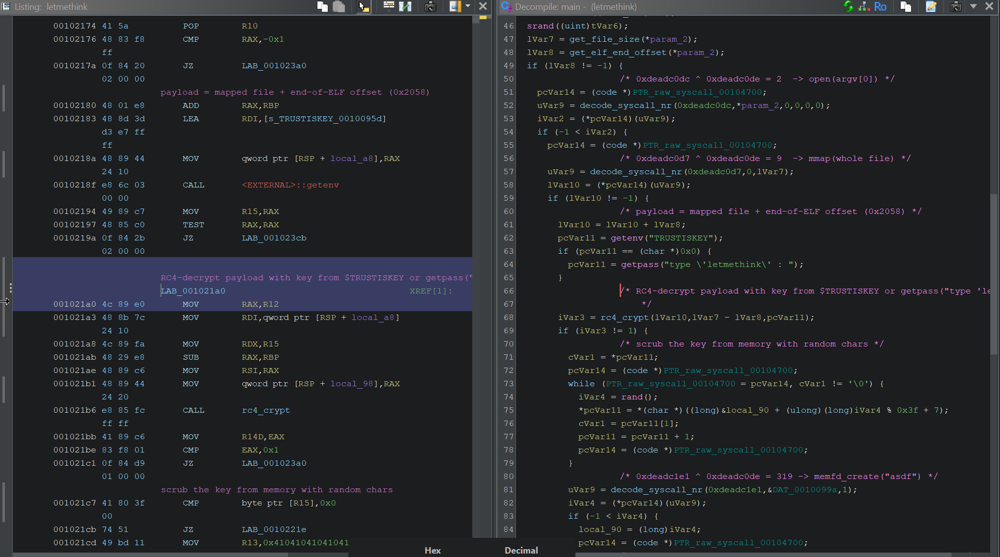
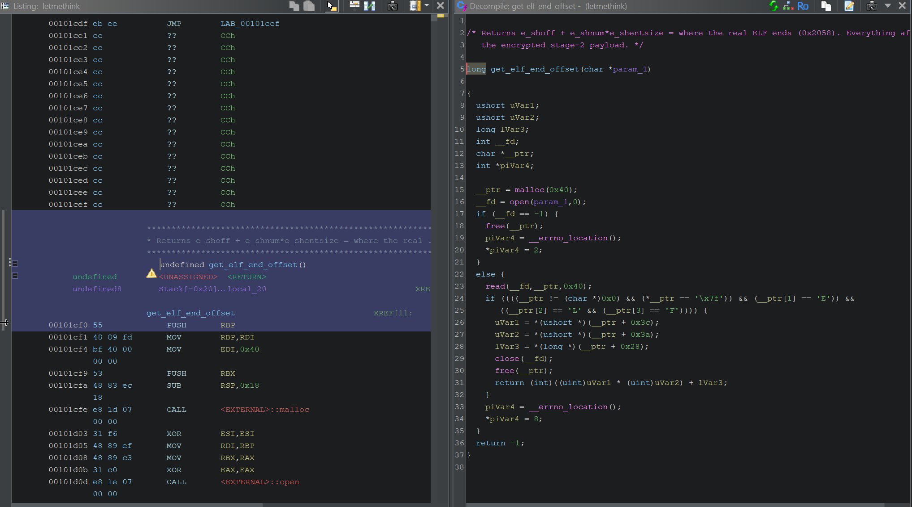
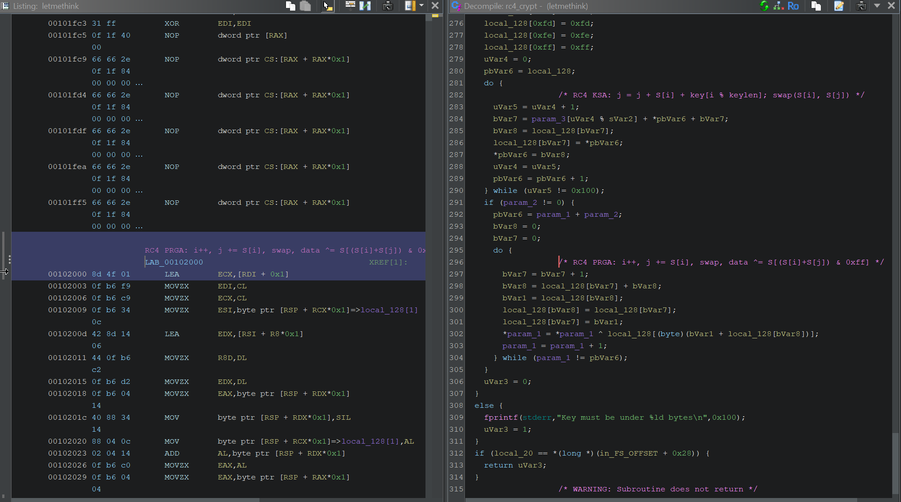
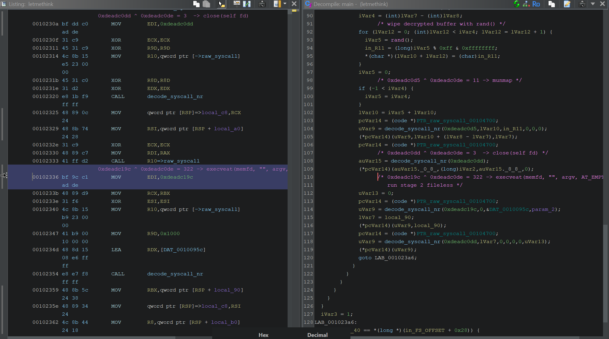
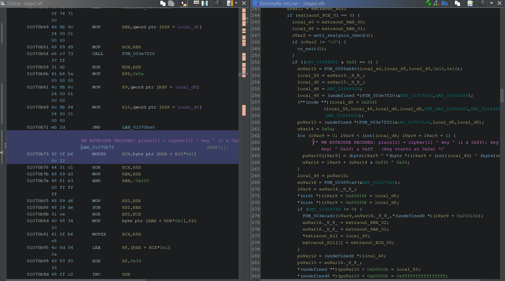
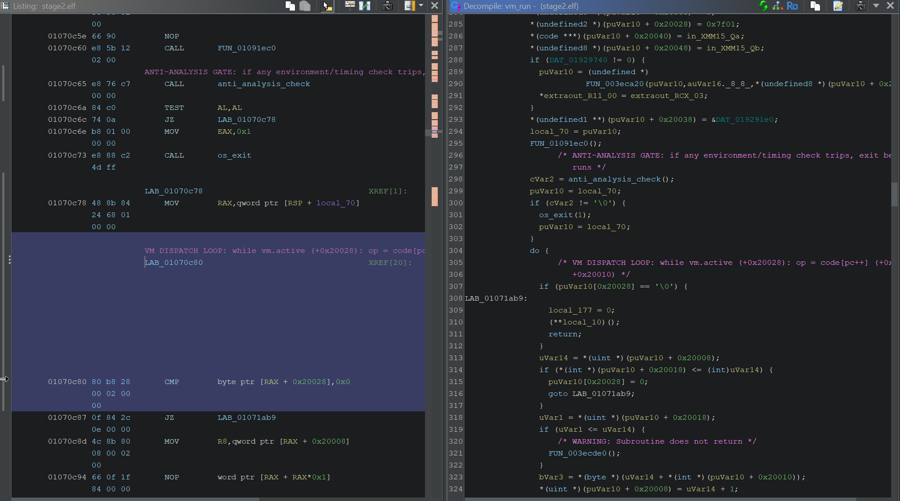
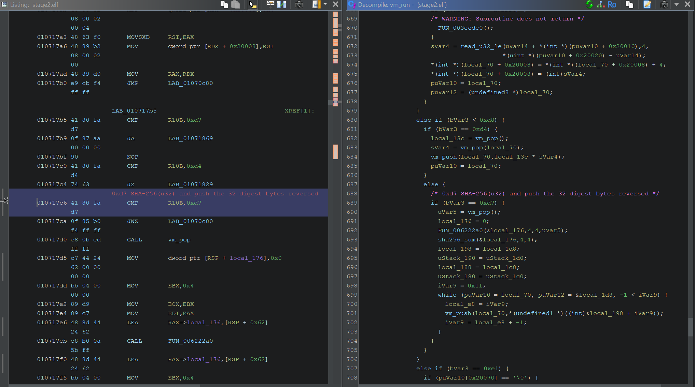
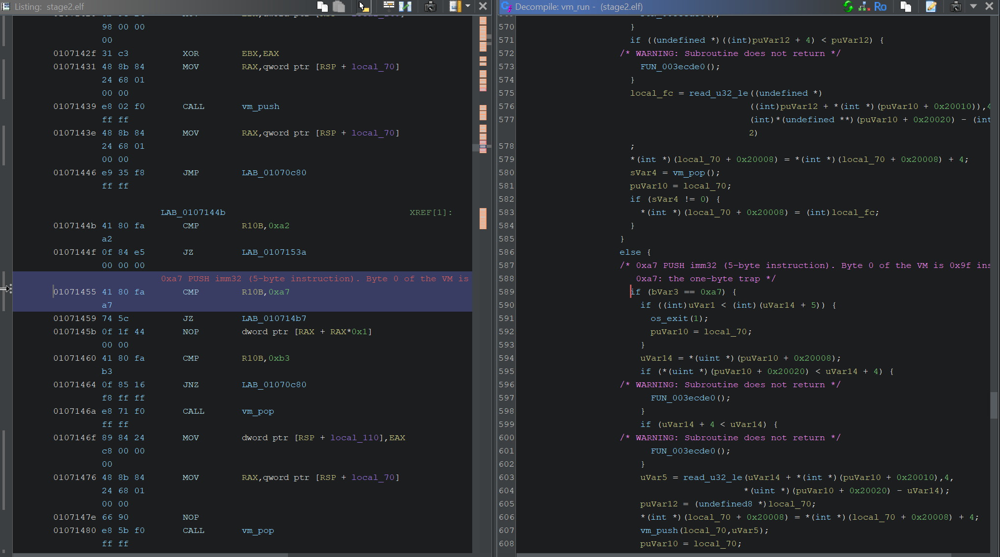
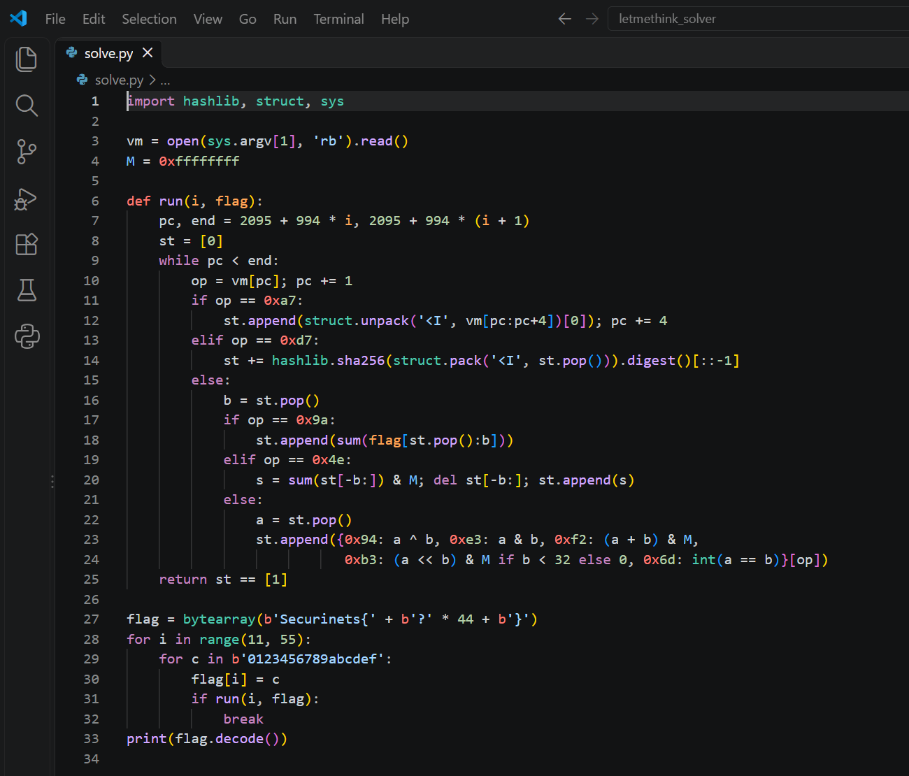
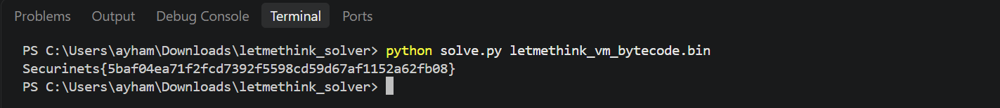

# letmethink

Securinets International Quals 2026, Reverse Engineering.

**Flag:** `Securinets{5baf04ea71f2fcd7392f5598cd59d67af1152a62fb08}`

## 1. Overview

We get one file: a 64-bit Linux ELF that is about 25 MB. That is far too big for a crackme, and in
Ghidra there are only around 2 KB of actual code, so most of the file is hiding something.

In short: a tiny C loader decrypts a Go program and runs it from memory, the Go program decodes a
small custom VM, and the VM checks the flag. The VM checks the flag one character at a time, so the
flag can be brute-forced character by character.

## 2. Stage 1: the loader

Ghidra did not find `main` by itself, so I followed the pointer passed to `__libc_start_main`
(`0x102080`), made a function there and renamed the helpers.

*Figure 1. `main` takes the key from the `TRUSTISKEY` environment variable, or asks you to type
`letmethink`. Then `rc4_crypt` decrypts the payload and the key gets wiped.*

So the key is `letmethink`; the program even tells you. Next question is where the encrypted data
starts.

*Figure 2. This reads the program's own ELF header and returns
`e_shoff + e_shnum * e_shentsize = 0x2058`. That is where the real ELF ends. Everything after it is
the payload.*

The decryption is plain RC4. The long list of `local_128[i] = i` at the top is the compiler
unrolling the S-box setup.

*Figure 3. `rc4_crypt`: key scheduling first, then the keystream XOR over the payload.*

The loader also does not call syscalls by name. It passes odd numbers like `0xdeadc0dc` to a small
wrapper, and the wrapper XORs them with `0xdeadc0de` to get the real syscall number. Once you see
that, `main` reads easily: `0xdeadc0dc` is 2 (`open`), `0xdeadc0d7` is 9 (`mmap`), `0xdeadc1e1` is
319 (`memfd_create`), `0xdeadc0df` is 1 (`write`), `0xdeadc0d5` is 11 (`munmap`), `0xdeadc0dd` is 3
(`close`) and `0xdeadc19c` is 322 (`execveat`). So it opens itself, maps the whole file, decrypts the
payload, writes it into a memfd and runs it.

*Figure 4. End of `main`. The decrypted program goes into a memfd and gets started with `execveat`,
so it never touches the disk.*

We already know the key and the offset, so there is no need to run anything. I took every byte after
`0x2058`, ran RC4 over it with the key `letmethink`, and got a file that starts with `\x7fELF`. It is
another 25 MB ELF, this time a stripped Go binary.

## 3. Stage 2: the VM

Stripped Go is awkward in Ghidra. There are no function names, and here Ghidra could not recover the
Go metadata either. The function I needed was not defined, so I created it at `0x10705e0` (file
offset `0xf705e0`) and called it `vm_run`.

*Figure 5. `vm_run`: anti-analysis check, then the loop that decodes the VM bytecode, then the VM
setup (stack pointer -1, pc 0).*

The VM bytecode is hidden with a rolling XOR. The key starts at `0x5a`, every byte is XORed with the
key and with its own index, and after each byte the key becomes `(index + key) ^ 0x33`.

Before the VM runs, the program calls `anti_analysis_check`. It does four checks: system info, the
parent process in `/proc`, some container checks, and a timing loop that catches single-stepping. If
any of them fires, it exits. To debug it I patched the start of that function to `xor eax,eax; ret`.
That does not touch the flag check.

*Figure 6. The anti-analysis gate, then the main VM loop. Each round it reads one opcode, does
`pc++` and runs the handler for it.*

It is a simple stack VM. Every opcode is one byte, except `0xa7`, which has a 4-byte number after it.
One extra trick: values on the VM stack are XORed with a mask byte while they sit in memory, so
dumping the stack does not show clean numbers.

*Figure 7. Opcode `0xd7`: pops a number, SHA-256s its 4 bytes and pushes the 32 hash bytes in
reverse order.*

*Figure 8. Opcode `0xa7`: reads the next 4 bytes and pushes them.*

The flag check only uses a handful of opcodes. `0xa7` pushes a number. `0x9a` is the one that reads
our input: it pops an end and a start and pushes the sum of `flag[start:end]`. `0x94`, `0xe3` and
`0xf2` are xor, and and add on the top two values, and `0xb3` is a left shift. `0xd7` is the SHA-256
one from above, and `0x4e` pops a count N and adds up the top N values (that is how the 32 hash bytes
get squashed back into one number). Finally `0x6d` compares the top two values and pushes 1 if they
are equal, 0 if not.

## 4. The first byte trap

I dumped the decoded VM at the dispatch loop; it is 57,872 bytes. The very first byte is `0x9f`, but
everything around it looks like `a7 <char> 2f` (push a char, print it). So that byte should really be
`0xa7`. With the wrong byte the program cannot print the prompt and just quits. Fix that one byte and
"Enter flag:" shows up.

## 5. How the check works

After the first 2095 bytes (prompt and reading input), the rest is 56 blocks of exactly 994 bytes.
The flag is 56 characters: `Securinets{`, 44 hex characters and `}`. Block `i` reads character `i`,
runs a lot of math and SHA-256 on it so it looks scary, and ends with `6d`, which leaves 1 if the
character is right and 0 if not.

That is the weakness. Guessing 44 hex characters at once is 16^44 tries. But since each block only
checks one character, we try the 16 options for each position, around 700 checks in total, and it is
done instantly. There is no need to reverse SHA-256; the solver runs the same instructions.

## 6. Solver

I wrote a small Python version of the VM that runs one block at a time. For every position it tries
`0-9` and `a-f` and keeps the one that makes the block return 1.

*Figure 9. `solve.py`. `run(i, flag)` executes block `i` of the VM, and the loop at the bottom tries
every hex digit for each position.*

Run it with the dumped VM file:

*Figure 10. Running it on the dumped VM prints the flag.*

I also checked it on the real binary: this flag prints `Correct!`, and changing even one hex digit
gives `Wrong!`.
